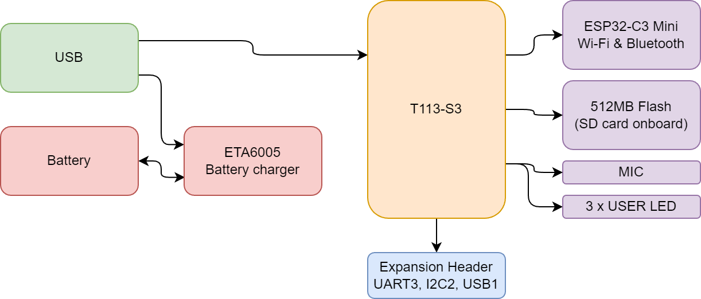
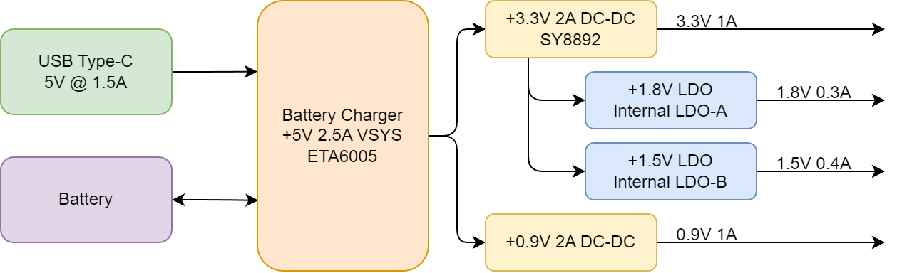
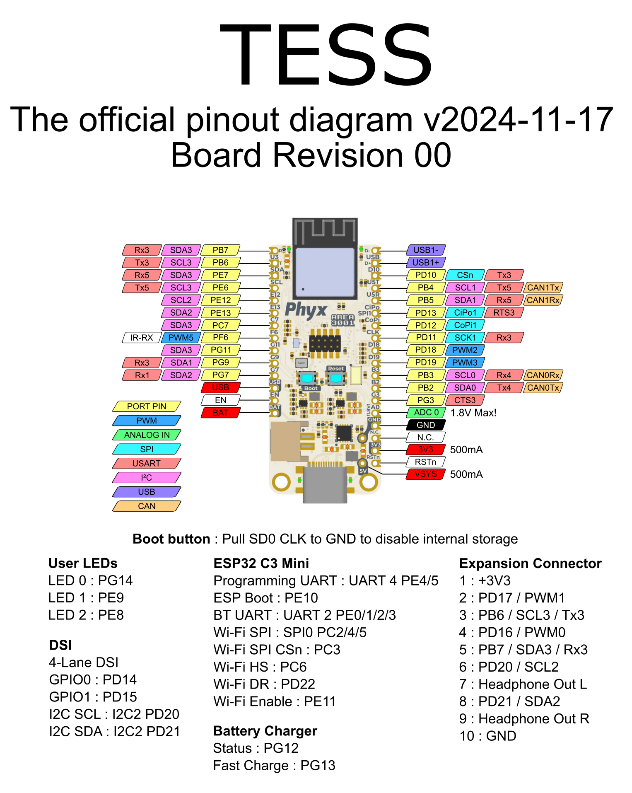

# TESS
## TESS
TESS is an Adafruit Feather compatible embedded Linux board based on the Allwinner T113-S3 SoC with 128MB of DDR3 RAM built-in. We did add some pins that are not in the original spec, these allow for USB and debug UART to be available on regular pinheaders. This SoC does however only have 1 ADC pin availble that is even limited to 1.8V, so the extra analog pins are replaced by digital pins with various mux options. Allowing for multiple I²C busses, UARTs and CAN interfaces to be used.
Some key features of TESS REV 00 are:
- [Allwinner T113-S3 SoC](https://linux-sunxi.org/T113-s3) with dual core Cortex A7 running at 1.2GHz and 128 MB DDR3 RAM
- 512 MB SD-storage soldered down
- [ESP32-C3-MINI-1](https://www.espressif.com/en/module/esp32-c3-mini-1-en) Wi-Fi and Bluetooth module
- battery charger (up to 1.2A selectable in software)
- Microphone
- 3 user LEDs
- [RPI Touch Display 2](https://www.raspberrypi.com/products/touch-display-2/) compatible DSI connector

## Software
TESS runs Linux built with [Buildroot](https://buildroot.org):
- [`buildroot-external/`](buildroot-external/): the Buildroot external tree with the TESS images (main image with A/B root filesystems and RAUC updates, USB flasher image, ESP32-C3 firmware). See its [README](buildroot-external/README.md) for how to build and install.
- [phyx-be/buildroot-tess](https://github.com/phyx-be/buildroot-tess), branch `phyxbe-tess`: Buildroot with the TESS board support (device tree, U-Boot configuration, minimal `phyxbe_tess_defconfig`), on its way to upstream Buildroot.

## Blockdiagram
TESS is designed to be a breakout board for the Allwinner T113-S3 with limited features on the board but maximal flexibility.

## Power
TESS has a 3.3V and 0.9V DC-DC regulator onboard whilst the T113-S3 has 2 LDO's built-in for the 1.8V and 1.5V rails.

## Pinout

