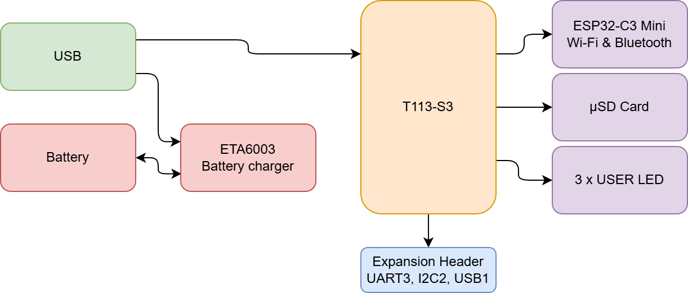
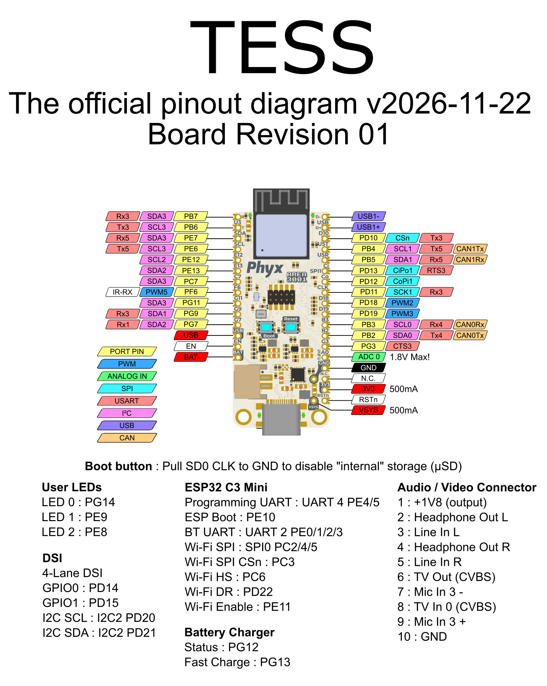
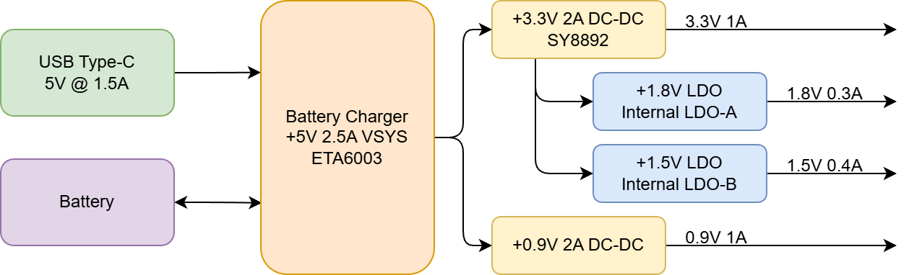

# TESS
## TESS
TESS is Phyx's take on a Linux-capable Feather. It has the familiar 0.9" × 2.0" Feather footprint and pinout, so most FeatherWings will fit. It also adds things a small MCU board can't do, like driving a Raspberry Pi touch display straight from the DSI connector, or running a full Linux system from a µSD card.

TESS is built around the **Allwinner T113-S3**. This SoC has two Arm Cortex-A7 cores, a HiFi4 DSP and **128 MB of DDR3 memory inside the chip package**, so there is no separate RAM chip on the board. An **Espressif ESP32-C3-MINI-1** module next to it handles Wi-Fi and Bluetooth LE.

### Features

- **Allwinner T113-S3 SoC**
  - Dual-core Arm Cortex-A7, 1 GHz class
  - HiFi4 DSP
  - 128 MB DDR3 in the same package
  - Built-in audio codec (headphone out, line in, microphone in) and composite video (CVBS) in/out
- **µSD card slot.** The operating system boots from the card. There is no flash memory on the board, so swapping the card swaps the whole system.
- **4-lane MIPI DSI connector** (22-pin, 0.5 mm pitch). Fits the Raspberry Pi 22-pin DSI cable, so the new Raspberry Pi touch displays work out of the box. Touch runs over the I²C lines in the same cable.
- **ESP32-C3-MINI-1 module** for basic 2.4 GHz Wi-Fi and Bluetooth LE. It connects to the T113 over SPI and UART, and the T113 can update the ESP32-C3 firmware by itself.
- **USB-C** for power and data (USB 2.0 device / OTG)
- **LiPo charger** (ETA6005) with a switchable charge current: **450 mA** by default, or **~1.2 A** for larger batteries
- **Feather pinout with 2 extra pins on each side.** These add a **second USB port** (USB1 D+/D−) and an **extra hardware UART** (UART3).
- **Audio/video expansion header**, 2 × 5 pins at 1.27 mm pitch: headphone L/R, line in L/R, differential mic in, CVBS out and CVBS in
- **3 user LEDs** controlled by software, plus **1 charge-status LED** driven by the charger
- **RESET** and **BOOT** buttons. Hold BOOT to open the µSD card on your PC over USB.
- **Hardware interfaces on the headers:** I²C, SPI, 2 × UART, 1 × ADC input, GPIO, USB host
- 3.3 V logic. The 3.3 V supply is a 2 A buck converter.

> [!WARNING]
> TESS has **only one analog input (A0)**, and it accepts **0 to 1.8 V at most**. Pins A1 to A5 keep their Feather names for compatibility, but on TESS they are **digital-only** GPIOs. See [Pinouts](#pinout).

## Software
Follow the development of our Buildroot Linux in the [`phyxbe-tess` branch](https://github.com/phyx-be/buildroot-tess/tree/phyxbe-tess) of our Buildroot fork, [phyx-be/buildroot-tess](https://github.com/phyx-be/buildroot-tess).

## Blockdiagram
TESS is designed to be a breakout board for the Allwinner T113-S3 with limited features on the board but maximal flexibility.

## Pinout

All GPIOs use **3.3 V logic** and are **not 5 V tolerant**. The T113 port names (`PB4`, `PE6`, ...) are the names Linux uses for these pins, for example in the device tree and with `gpiod` tools.

### Power pins

| Pin | Description |
|---|---|
| **USB** | 5 V straight from the USB-C connector. Only present when USB is plugged in. |
| **VBAT** | LiPo battery voltage (3.0 to 4.2 V) |
| **EN** | Enable for the 3.3 V regulator. Pulled high. Tie it to GND to switch the board off. The charger keeps working. |
| **3V3** | Output of the 3.3 V regulator. Up to about 500 mA is available for external parts. |
| **GND** | Ground. All GND pins are connected. |
| **AREF** | **Not connected** on TESS. The ADC uses its own internal reference. |
| **RST** | Reset input, active low. Same as pressing the RESET button. |

### 16-pin side

| Feather name | T113 pin | Main function | Notes |
|---|---|---|---|
| RST | RESET | Reset | Active low |
| 3V3 | – | 3.3 V out | |
| AREF | – | – | Not connected |
| GND | – | Ground | |
| **A0** | GPADC0 | **Analog in** | **The only analog input. 0 to 1.8 V max!** |
| A1 | PG3 | GPIO | Digital only |
| A2 | PB2 | GPIO | Digital only |
| A3 | PB3 | GPIO | Digital only |
| A4 | PD19 | GPIO | Digital only |
| A5 | PD18 | GPIO | Digital only |
| SCK | PD11 | SPI1 CLK | |
| MO | PD12 | SPI1 MOSI (CoPi) | |
| MI | PD13 | SPI1 MISO (CiPo) | |
| RX | PB5 | UART5 RX | |
| TX | PB4 | UART5 TX | |
| *(spare)* | PD10 | GPIO / SPI1 CS | Not connected on a standard Feather |
| **Extra 1** | USB1 D+ | **USB 2.0 host port** | Non-standard extra pin |
| **Extra 2** | USB1 D− | **USB 2.0 host port** | Non-standard extra pin |

### 12-pin side

| Feather name | T113 pin | Main function | Notes |
|---|---|---|---|
| VBAT | – | Battery voltage | |
| EN | – | Regulator enable | |
| USB | – | 5 V from USB-C | |
| D13 | PG7 | GPIO | |
| D12 | PG9 | GPIO | |
| D11 | PG11 | GPIO | |
| D10 | PF6 | GPIO | |
| D9 | PC7 | GPIO | |
| D6 | PE13 | GPIO | |
| D5 | PE12 | GPIO | |
| SCL | PE6 | I2C3 SCL | |
| SDA | PE7 | I2C3 SDA | |
| **Extra 1** | PB6 | **UART3 TX** | Non-standard extra pin |
| **Extra 2** | PB7 | **UART3 RX** | Non-standard extra pin |

Most pins have other functions too, such as PWM, extra UARTs, I²C, CAN and IR receive. The pinout diagram shows them. The pin multiplexing is set in the Linux device tree.

### The extra pins: USB and UART

A standard Feather has 16 + 12 pins. TESS adds **2 pins at the end of each header row**, on the end opposite the USB-C connector:

- **USB1 D+ / D−** next to the 16-pin row. This is a second, independent USB 2.0 port on the T113. Use it to connect a USB device such as a keyboard, a USB stick or a USB-to-Ethernet dongle without tying up the USB-C port.
- **UART3 TX / RX** next to the 12-pin row. This is a hardware serial port that is free for your own use, separate from the Feather RX/TX pins.

> [!IMPORTANT]
> The USB1 port has only the data lines. A USB device also needs 5 V: take it from the **USB** pin, which only has 5 V while TESS is powered over USB-C, and from **GND**. Keep the D+/D− wires short and twisted together.

> [!NOTE]
> Because of these 2 extra pins, a TESS with **full-length (18-pin and 14-pin) headers** won't fit in every Feather socket or doubler. Most FeatherWings still fit, because they line up from the USB end. You can also solder standard 16-pin and 12-pin headers and leave the extra pins unpopulated.

### The analog input (A0)

The T113 has a single general-purpose ADC channel, `GPADC0`, routed to **A0**.

- Input range: **0 to 1.8 V**. The ADC runs from the SoC's 1.8 V analog supply.
- **Never apply more than 1.8 V** to A0. For 3.3 V or higher signals, use a resistor divider. For example, 10 kΩ over 12 kΩ scales 3.3 V down to 1.8 V.
- If you need more analog channels, add an I²C ADC breakout through the SCL/SDA pins.

## Power Management

### Powering TESS

TESS runs from either:

- **USB-C**, 5 V. Use a supply that can deliver at least 1 A, or more if you use a display or fast charging.
- **A single-cell LiPo/Li-ion battery** (3.7 V nominal) on the **2-pin 2.0 mm JST battery connector**

When both are connected, the board runs from USB and charges the battery at the same time. The charger's power-path output (VSYS, 3.6 to 4.7 V) feeds two buck converters: one for **3.3 V** (I/O, Wi-Fi, µSD) and one for the **0.9 V** CPU core. The SoC makes its own 1.8 V supply internally.

> [!WARNING]
> Check the battery polarity before plugging it in. Battery connectors aren't standardised between vendors, and a reversed battery will damage the board.

### Charge current: standard or fast

The ETA6005 charger has two charge-current settings, and the T113 chooses between them using pin **`PG13` (Fast Charge)**:

| `PG13` state | Charge current | Use for |
|---|---|---|
| Input / high-impedance (**default**) | **~450 mA** | Small batteries, roughly 500 mAh and up |
| Driven **low** | **~1.2 A** | Large batteries, roughly 1200 mAh and up |

The default is the safe, low setting, so any common LiPo can be connected. If you use a large battery, switch to fast charging in software so it charges in a reasonable time.

> [!CAUTION]
> To go back to standard charging, set `PG13` back to an **input**. **Never drive `PG13` high.**
> As a rule of thumb, keep the charge current at or below 1C. Don't use fast charging with batteries under about 1200 mAh.

### Charge status

- The **charge LED** (CHG, next to the USB-C connector) is driven directly by the charger. It works even before Linux has booted:
  - **On:** charging
  - **Off:** charging done, or no battery connected
- Software can read the same signal on **`PG12` (Battery Charger Status)**. It is low while charging.

### Turning the board off

Pull the **EN** pin to GND, for example with a slide switch between EN and GND. This turns off the 3.3 V and core regulators and shuts down the board. The charger stays active, so the battery still charges over USB while the board is off.

### Power budget

| Consumer | Typical peak |
|---|---|
| ESP32-C3 Wi-Fi (transmitting) | ~450 mA at 3.3 V |
| External devices on the 3V3 pin | up to ~500 mA |

A DSI display adds its own load. See [Display](#display-mipi-dsi).

## Display (MIPI DSI)

TESS has a **22-pin, 0.5 mm pitch MIPI DSI connector** with the same pinout as the display connector on the Raspberry Pi 5 and Compute Module boards. The new Raspberry Pi touch displays plug straight in with the **22-pin to 22-pin cable** (the "Raspberry Pi 5" cable).

- **4 data lanes** plus the clock lane
- **I²C2** (`PD20` SCL, `PD21` SDA) on the connector for touch and panel control, with 4.7 kΩ pull-ups on the board
- **Two display GPIOs**: `PD14` (DSI GPIO0) and `PD15` (DSI GPIO1)
- 3.3 V supply on the connector for the panel logic

### Connecting a display

1. Unplug USB and the battery.
2. Open the latch on the ZIF connector by gently lifting it.
3. Push the cable in all the way, **with the contacts facing the board**, then close the latch.
4. Connect the display's power input to the **USB** (5 V) and **GND** pins on TESS.

> [!NOTE]
> The display's backlight is not powered through the DSI cable, so the display needs 5 V from the **USB** pin. This means the display only works while TESS is powered over USB-C.

### DSI connector pinout

| Pin | Signal | Pin | Signal |
|---|---|---|---|
| 1 | GND | 12 | DSI D2+ |
| 2 | DSI D0− | 13 | GND |
| 3 | DSI D0+ | 14 | DSI D3− |
| 4 | GND | 15 | DSI D3+ |
| 5 | DSI D1− | 16 | GND |
| 6 | DSI D1+ | 17 | GPIO0 (PD14) |
| 7 | GND | 18 | GPIO1 (PD15) |
| 8 | DSI CLK− | 19 | GND |
| 9 | DSI CLK+ | 20 | I2C2 SCL (PD20) |
| 10 | GND | 21 | I2C2 SDA (PD21) |
| 11 | DSI D2− | 22 | +3.3 V |

## Wi-Fi & Bluetooth (ESP32-C3)

TESS gets its wireless connection from an **ESP32-C3-MINI-1** module with 4 MB flash and a PCB antenna. The module acts as a co-processor for the T113:

| Function | Connection |
|---|---|
| Wi-Fi data | SPI0 (`PC2` CLK, `PC4` MOSI, `PC5` MISO), CS `PC3`, plus handshake `PC6` and data-ready `PD22` lines |
| Bluetooth HCI | UART2 with flow control (`PE2` TX, `PE3` RX, `PE0`/`PE1` RTS/CTS) |
| ESP32-C3 programming | UART4 (`PE4` TX, `PE5` RX) |
| ESP32-C3 boot mode | `PE10` |
| ESP32-C3 enable / reset | `PE11` |

The T113 controls the module's enable and boot pins, so **the T113 can reflash the ESP32-C3 by itself**. You never need to wire an external programmer to the module.

Use this as a **basic network connection**: SSH, updates, MQTT, a small web interface. It is not meant for high-throughput streaming.

> [!TIP]
> Keep metal, batteries and ground planes away from the end of the board where the module's antenna is, to get the best range.

## Audio & Video Expansion Header

The T113 has a built-in audio codec and composite-video (CVBS) interface. These signals go to a **2 × 5 pin, 1.27 mm pitch** header in the middle of the board.

| Pin | Signal | Pin | Signal |
|---|---|---|---|
| 1 | +1.8 V (output) | 2 | Headphone out L |
| 3 | Line in L | 4 | Headphone out R |
| 5 | Line in R | 6 | TV out (CVBS) |
| 7 | Mic in 3 − | 8 | TV in 0 (CVBS) |
| 9 | Mic in 3 + | 10 | GND |

- **Headphone out L/R:** the T113's headphone amplifier output. It can drive headphones directly. Connect a speaker through a small amplifier.
- **Line in L/R:** stereo analog input at line level.
- **Mic in 3 +/−:** differential microphone input, for an electret mic or a mic with a preamp.
- **TV out:** composite video (CVBS) to an analog monitor or small TFT with an AV input.
- **TV in 0:** composite video input, for an analog camera for example.
- **+1.8 V:** a reference/supply output for small analog circuits such as mic bias. Draw only a few mA from it.

> [!WARNING]
> These are analog pins of the SoC, and many work in the 1.8 V domain. **Don't connect them to 3.3 V or 5 V signals.** Use coupling capacitors when you connect external audio gear.

## µSD Card & BOOT Button

### µSD card

TESS has **no flash memory on the board**. The T113 boots the complete operating system from the **µSD card** (on the bottom side of the board). Without a card that holds a bootable image, the board won't start.

Use a good quality card of 8 GB or more, class A1 or better.

### Accessing the µSD card from your PC (BOOT button)

You don't need to take the card out to change files on it or reflash it:

1. **Hold down the BOOT button.**
2. Plug TESS into your computer with USB-C, or press RESET while still holding BOOT.
3. Release BOOT. The µSD card shows up on your computer as a **USB drive**.

This makes it easy to change configuration files, copy your own programs onto the card, or write a new system image to it.

> [!NOTE]
> **How it works:** the BOOT button pulls the µSD clock line (SDC0 CLK) to GND. When the button is held during start-up, the T113's boot ROM can't read the card and falls back to its built-in **USB bootloader (FEL mode)** on the USB-C port. That is also the recovery path if the card's contents are ever corrupted.

### RESET button

Press **RESET** to restart the board. It does the same as pulling the **RST** pin low.

## LEDs

TESS has **four LEDs**:

| LED | Controlled by | T113 pin | Behaviour |
|---|---|---|---|
| **LED 0** | Software | `PG14` | User LED. Active low: drive the pin low to turn it on. |
| **LED 1** | Software | `PE9` | User LED. Active low. |
| **LED 2** | Software | `PE8` | User LED. Active low. |
| **CHG** | Battery charger | – (status readable on `PG12`) | On while charging, off when done or with no battery |

The three user LEDs are free for your own use: heartbeat, Wi-Fi status, µSD activity, and so on. In Linux they are normally set up as `gpio-leds` in the device tree, so you can control them from `/sys/class/leds/`.

## Specifications

| | |
|---|---|
| SoC | Allwinner T113-S3: 2 × Arm Cortex-A7, HiFi4 DSP |
| Memory | 128 MB DDR3 (in package) |
| Storage | µSD card (boot and root file system) |
| Wireless | ESP32-C3-MINI-1-N4: 2.4 GHz Wi-Fi 4, Bluetooth LE 5 |
| Display | MIPI DSI, 4 lanes, 22-pin 0.5 mm FPC (Raspberry Pi compatible) |
| USB | USB-C (USB 2.0 device / OTG), plus USB 2.0 host on the extra header pins |
| Analog in | 1 channel, 0 to 1.8 V |
| Audio/video | Headphone out, stereo line in, differential mic in, CVBS in/out |
| Serial | UART5 (Feather RX/TX), UART3 (extra pins) |
| I²C / SPI | I2C3 (Feather SDA/SCL), SPI1 (Feather SCK/MO/MI) |
| Battery | 1-cell LiPo/Li-ion, 2-pin 2.0 mm connector, 450 mA / 1.2 A charging |
| Supply | 5 V over USB-C or battery |
| Logic level | 3.3 V (A0: 1.8 V max) |
| Size | Feather form factor, approx. 51 × 23 mm (2.0" × 0.9") |